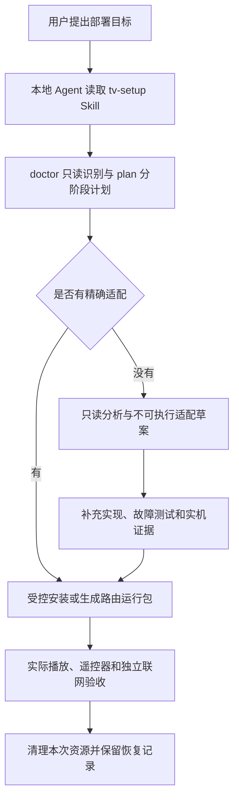

# TV Setup Agent

**一条命令，把 Android 电视安装、固件适配、路由分流和 YouTube 排障能力交给本地 AI Agent。**

[安装](#1-一条命令安装) · [支持范围](#3-当前支持范围) · [完整流程](#5-完整使用流程) · [命令参考](#6-命令参考) · [新型号适配](#8-如何适配新设备) · [常见问题](#10-常见问题)

当前版本：**`0.1.0-preview.1`**，属于预览版。原始实机路径已经验证；通用安装包尚未在另一套空白设备完成完整部署验证，不能据此推定整个品牌兼容。

## 为什么需要这个项目

让一台电视真正可用，往往不止是安装一个 APK：

- 系统可能限制 ADB 安装应用，或限制第三方桌面成为默认首页。
- 相同品牌的不同固件，设置入口、安装策略和权限也可能不同。
- 电脑能访问 YouTube，不代表电视具有相同的网络路径。
- 路由器运行代理核心后，还要处理 DNS、分流、启动恢复、校时和管理链。
- 官方 YouTube 提示设备不支持，需要区分网络、客户端和设备兼容问题，再实际验证播放。

本项目复用 [CleanYourTV](https://github.com/Gathin23/cleanyourtv)、[SmartTube](https://github.com/yuliskov/SmartTube)、[Mihomo](https://github.com/MetaCubeX/mihomo) 等项目，补充设备适配、执行工具和验收流程，让 Agent 根据现场条件连续完成工作。

## 1. 一条命令安装

### 推荐：安装到 Codex 和 Claude Code

在准备处理电视任务的**本地项目目录**运行：

```sh
npx --yes skills@1.7.4 add leslieyeo/tv-setup-agent --skill tv-setup --agent codex --agent claude-code --yes
```

命令使用 [Skills CLI](https://github.com/vercel-labs/skills)，默认安装到当前项目。这里固定的是安装工具的版本，工具包来自本仓库当前分支。

| 条件 | 用途 |
|---|---|
| Node.js **22.20.0+** | 上述 Skills CLI 需要；本地 Python 安装方式不需要 Node.js |
| Python **3.9+** | 运行本包执行器，只有标准库依赖 |
| 本地文件、终端和局域网访问能力 | Agent 必须能访问用户家里的设备，远程聊天容器通常不具备这条管理链 |

在没有同名 Skill 的项目中首次安装。已有 `tv-setup` 时先确认来源和本地修改；`--yes` 会跳过 Skills CLI 的交互确认，不要覆盖其他人的同名内容。

只装一个 Agent 时：

```sh
# Codex
npx --yes skills@1.7.4 add leslieyeo/tv-setup-agent --skill tv-setup --agent codex --yes

# Claude Code
npx --yes skills@1.7.4 add leslieyeo/tv-setup-agent --skill tv-setup --agent claude-code --yes
```

其他本地 Agent 可以使用 Skills CLI 支持的对应 Agent 名称，或显式读取自包含目录 [`skills/tv-setup`](skills/tv-setup)。本项目验证了项目级文件安装和 CLI，不把安装器支持的 Agent 列表等同于所有宿主都经过实际调用测试。

### 不使用 Node.js：本地 Python 安装

通过 GitHub 的 **Code → Download ZIP** 下载源码并解压，或自行克隆。在目标项目中执行：

```sh
python3 "/解压位置/tv-setup-agent/install.py" --agent both --project .
```

使用实际的 `install.py` 完整路径；GitHub下载ZIP解压后的目录名可能带 `-main`，不要照抄示例目录名。`--agent` 支持 `codex`、`claude-code`、`both`、`generic`。

Python 安装器校验 `package-manifest.json`，把运行文件放入 `.tvsetup/toolkit`，再为各 Agent 建立同源链接；重复安装时检查已有文件，遇到同名冲突或本地修改会停止并保留原文件。它不改全局 Agent 配置，也不连接或修改电视、路由器和电脑网络。

两种方式选择一种即可。Python 安装器有自己的完整性和冲突检查；Skills CLI 使用它自身的安装、覆盖和更新规则。

### 安装后调用

- Codex：**`$tv-setup`**。
- Claude Code：**`/tv-setup`**。
- 其他本地 Agent：读取安装目录的 `SKILL.md`；Python `generic` 模式另有 `.tvsetup/START_HERE.md`。

当前会话尚未发现新 Skill 时，把实际 `SKILL.md` 路径交给 Agent 读取，或重新进入该项目。Python 安装器会输出完整入口路径。

可以直接交给 Agent 这段需求：

> 使用 tv-setup，把我的 Android 电视配置成简洁桌面，并能在电脑关闭后独立观看 YouTube。先识别电视、路由器和网络，保留已经可用的设置；匹配已验证适配，未知固件先只读研究。需要改变家庭网络、重置或刷机时，先给出具体影响和回退方案；在已有授权范围内连续完成普通步骤。最后验证遥控器启动、实际音画和重启恢复，并清理本次临时资源。

**安装命令安装的是 Agent 能力。** 电视需要开机并允许首次 ADB 授权，凭据和订阅需要用户提供授权来源，必要的物理接线也需要现场完成。

## 2. 它如何工作



| 部分 | 作用 |
|---|---|
| Skill | 指导 Agent 判断现场条件、复用已有配置、选择流程和验收 |
| Python CLI | 执行需要固定约束的操作：识别、摘要校验、安装策略事务、运行包生成等 |
| 适配记录与参考流程 | 记录精确固件、接口、前置条件、证据和回退方法 |

未知设备不会因为品牌或CPU相似，就直接套用另一个型号的私有接口。

## 3. 当前支持范围

### 电视与客户端

| 场景 | 当前行为 | 证据和限制 |
|---|---|---|
| 已授权的 Android ADB 设备 | 读取固件、API、ABI、已有应用和默认HOME | 不自动开启调试或绕过首次授权 |
| 雷鸟销售样本 **FF75F295C-FA65** | 精确匹配后支持本机适配的 CleanYourTV 和受控安装策略恢复 | 原始实机安装、首页、重启和播放已验证；不是全部雷鸟/TCL |
| 其他 Android 电视 | 可尝试符合最低要求的标准ADB客户端安装；被限制时研究 | 不写TCL Provider，不使用这份TCL专用桌面包 |
| SmartTube F-Droid | 固定候选 **32.56 / versionCode2446**，Android5.0+，包含ARMv7、ARM64、x86 | 原样本匿名播放有实际音画；长期可用性需维护 |
| 官方 YouTube | Agent复现并判断错误 | 不承诺改变设备认证状态或保证官方App可用 |

当前自动 OEM 安装路径只匹配以下完整指纹及 API30：

```text
TCL/tc8000_ay30a2/tc8000_ay30a2:11/RQ3A.210705.001/2026030620:user/release-keys
```

这是产品和固件标识，不是设备序列号。固件升级后即使销售型号相同，也可能需要重新验证。

### 路由器

| 场景 | 当前能力 | 限制 |
|---|---|---|
| RT-AC68U / Merlin **386.14_2** / Linux **2.6.36.4brcmarm** / armv7l | 认证只读识别、生成私有分流运行包与恢复阶段 | 原始实验成功；新包尚未在另一台空白路由器回归 |
| 相同适配下的无线回程 | 生成eth2的5GHz station上联、2.4GHz/LAN下联参考服务及NVRAM恢复 | 不自动改主路由信道，不自动下发或启用 |
| 已有分流或启动脚本 | 保留并优先验证 | 当前全新环境模板拒绝覆盖已有代理、hooks或不匹配拓扑 |
| 其他ASUS、内核、OpenWrt、小米等 | 收集证据，选择正常支持路径或新增适配 | 没有通用刷机或一键路由改造功能 |

**路由 CLI 当前生成运行包，实际部署由 Agent 分阶段执行。** 节点来自用户明确指定的本地provider文件，订阅自动刷新尚未封装。当前方案为TCP透明代理、DNS分流、IPv6代理关闭和QUIC回落，其他UDP不经过代理，不能描述为全协议VPN。

## 4. 开始前准备什么

1. 让本地执行器能访问电视所在局域网。电视与电脑处于能互访的网络即可；路由改造另有独立电脑出口要求。
2. 电视保持开机、开启适用的ADB调试、允许首次连接。记下电视自己的IPv4地址，网关地址通常属于路由器。
3. 准备Google的 [platform-tools](https://developer.android.com/tools/releases/platform-tools)。`adb` 在PATH中时无需额外参数，否则使用 `--adb /实际路径/adb`。
4. 仅在确实需要改路由时，准备正常管理员访问、任务SSH密钥、已核实的主机指纹和配置备份。通过正常管理流程开启所需LAN管理，不为省步骤开放WAN管理。
5. 提供明确授权的本地provider文件。密码、订阅URL和私钥不要放进聊天、公共Issue或仓库。

已有网络能让电视播放，就跳过路由改造。Mac/Linux是首版目标；Windows的链接权限、网络保护和设备部署尚未验证。

## 5. 完整使用流程

日常可让 Agent 读取 Skill 后执行。下面列出关键命令，手动操作时先理解阶段及适配范围。

### 5.1 找到执行器

同时安装到 Codex/Claude Code 后：

```sh
TVSETUP=".agents/skills/tv-setup/scripts/tvsetup.py"
python3 "$TVSETUP" --help
python3 "$TVSETUP" check-package
```

只安装到Claude Code时可使用 `.claude/skills/tv-setup/scripts/tvsetup.py`。直接操作源码时，也可以运行根目录 `python3 tvsetup.py ...`。

`check-package` 校验内置资源，**不证明设备兼容**，也不下载全部外部组件。

### 5.2 只读识别与计划

```sh
# 仅为示例，必须换成电视实际地址。
TV_SERIAL="192.168.100.40:5555"

python3 "$TVSETUP" doctor --tv "$TV_SERIAL" --out .tvsetup/state/inventory.json
python3 "$TVSETUP" plan --inventory .tvsetup/state/inventory.json --out .tvsetup/state/plan.json
```

`doctor` 读取电脑默认出口、电视固件/API/ABI、已有应用、HOME和代理是否配置；附加路由参数后还可读路由身份。它不会重置设备、改电脑路由或读取整机个人数据。

`plan` 标出支持的步骤、可以跳过的已有功能和需要输入/研究的部分。执行器在写入前重新核对关键设备条件，不单凭旧报告操作。

### 5.3 安装桌面和客户端

```sh
# 专用桌面仅用于上述精确TCL指纹。
python3 "$TVSETUP" tv-install launcher-tcl --tv "$TV_SERIAL" --set-home

# 客户端先走标准ADB安装。
python3 "$TVSETUP" tv-install smarttube-fdroid --tv "$TV_SERIAL"
```

已安装的同名包默认保留，不自动卸载或覆盖不同签名。桌面APK是基于CleanYourTV的本机适配构建，含TCL设置面板入口修改，**不是上游官方发行版**；来源、补丁和许可随包提供。

OEM安装事务：普通包管理器优先；仅在完整固件匹配、返回已验证的 `INSTALL_FAILED_VERIFICATION_FAILURE` 时使用对应接口。先保存原始完整策略，再临时调整审查过的字段；结束或失败后原文恢复、读回逐字比较，删除本次随机路径helper并保留恢复日志。

超时会尝试恢复；断电、强制终止或ADB长期断开不能保证 `finally` 完成，要保留日志并使用恢复命令。用户取消、签名冲突、空间不足或未知固件，不会被当作已验证OEM策略失败直接放行。

详见[电视安装与恢复](skills/tv-setup/references/tv-install.md)。

### 5.4 需要时配置路由分流

改路由前，电脑应有独立正常出口，例如通过主路由Wi-Fi上网，通过不带默认网关/DNS的辅助网卡管理待配置路由器。临时改网卡时保存原值，调试后恢复。不要在电脑依赖该路由器作为唯一出口时直接重启或改WAN。

```sh
# 路由地址、密钥和known_hosts均换成现场实际值。
python3 "$TVSETUP" doctor \
  --router 192.168.100.1 \
  --ssh-key .tvsetup/private/router-key \
  --known-hosts .tvsetup/private/known_hosts \
  --out .tvsetup/state/router-inventory.json

python3 "$TVSETUP" guard-network \
  --inventory .tvsetup/state/router-inventory.json \
  --router 192.168.100.1

python3 "$TVSETUP" asus-bundle \
  --inventory .tvsetup/state/router-inventory.json \
  --provider-file .tvsetup/private/authorized-provider.yaml \
  --selected-node "你的节点名称" \
  --out .tvsetup/private/asus-bundle
```

`guard-network` 比较当前默认出口和基线，失败就停止路由写入；它本身不改网络。桌面TUN接管下的TCP连接成功，不能代替真实设备身份检查。

`asus-bundle` 不向路由器下发。它要求认证身份、精确固件/内核、路由模式和br0、/24 LAN、空启动脚本环境和足够资源，并拒绝覆盖已有代理。当前阈值为内存约192MiB、JFFS空闲28000KiB、/tmp空闲80000KiB。

| 生成的阶段文件 | 作用 |
|---|---|
| `stage-core.sh` | 核对身份、冲突和核心配置，只启动显式代理 |
| `arm-rollback.sh` | 安排路由器端10分钟运行期回退 |
| `activate-lan.sh` | 检查前序验证和回退进程，再启用自有LAN链 |
| `enable-boot.sh` | 全新hooks环境下，完成LAN验收后启用自启 |
| `disarm-rollback.sh` | 验收后解除本轮计时回退 |
| `rollback.sh` | 停止本次服务、清自有链、按校验结果恢复本次hooks |

Agent实际验证核心、DNS、规则、客户端和管理边界后，才能写相应验证标志；不能因为文件生成就标记 `CORE_VERIFIED` 或 `LAN_VERIFIED`。运行期计时器不跨重启，自启还需受控重启验收。

旧内核还要实际检查候选二进制。本包保留了原始AC68U实验成功运行的特定ARMv5 softfloat Mihomo，不能只看到ARMv7就替换任意新版核心。

完整阶段与回退：[ASUS路由部署](skills/tv-setup/references/asus-router.md)。

### 5.5 需要时增加无线回程

该适配让AC68U的5GHz无线电专门连接主路由，2.4GHz和LAN服务下游，客户端5GHz广播不再保留。

```sh
python3 "$TVSETUP" asus-wireless-snapshot \
  --router 192.168.100.1 \
  --ssh-key .tvsetup/private/router-key \
  --known-hosts .tvsetup/private/known_hosts \
  --out .tvsetup/private/wan-before.json

python3 "$TVSETUP" asus-wireless-render \
  --bundle .tvsetup/private/asus-bundle \
  --nvram-before .tvsetup/private/wan-before.json \
  --wifi-secret-file .tvsetup/private/upstream-wifi.json
```

`upstream-wifi.json` 由用户通过本地安全输入提供 `ssid` 和 `password`，不要贴到公共反馈。渲染器生成SSID专用WPA2 PMK、真实设备恢复记录和参考服务，不复制明文密码到生成包；PMK仍是敏感凭据。

这些命令只读快照和生成文件，**不连接无线、不改主路由信道、不自动启用**。Agent还需检查允许信道、认证、桥和WAN、启动事件、校时、无上联网线重启恢复及客户端播放。

若需要改主路由信道，先说明影响和原值恢复方式；不靠改国家码或超功率代替兼容检查。覆盖和吞吐需放到实际位置测试。

完整流程：[无线回程适配](skills/tv-setup/references/wireless-uplink.md)。

### 5.6 实际播放验收

```sh
python3 "$TVSETUP" playback-test --tv "$TV_SERIAL"
```

命令启动公开Blender样片并观察进度，报告 `progress_observed`；不会自动把“进度前进”当“现场看到画面和听到声音”。

验收包括：遥控器首页进入桌面、启动客户端、实际音画、暂停/恢复、国内应用可用、独立分流时电脑断开后仍能播放。启用持久服务后，还应确认重启后的网络、DNS、时间和服务恢复。

硬件视频层可能不出现在ADB截图中，截图黑色不直接等于电视黑屏。4K60缓冲时先比较1080p60，再区分无线吞吐、节点与解码。账号、会员内容、HDR、投屏、语音和长时间4K分别记录是否测试。

详见[播放兼容与验收](skills/tv-setup/references/playback.md)。

## 6. 命令参考

用 `python3 tvsetup.py <命令> --help` 查看实际参数。

| 命令 | 作用 | 写入范围 |
|---|---|---|
| `doctor` | 识别电脑、电视和可选路由 | 本地报告；设备只读 |
| `plan` | 生成阶段计划 | 本地计划 |
| `check-package` | 校验内置资源 | 不连设备 |
| `fetch` | 下载固定摘要的外部组件 | 本地缓存 |
| `tv-install` | 安装指定客户端/桌面，可设HOME | 匹配电视及本地恢复记录 |
| `recover-policy` | 恢复同设备同固件原始策略 | 对应电视 |
| `restore-home` | 还原已保存HOME，不卸载应用 | 对应电视 |
| `playback-test` | 启动样片、记录进度 | 电视播放状态及本地报告 |
| `guard-network` | 比较默认出口和基线 | 只读 |
| `asus-bundle` | 生成分阶段分流包 | 私有本地文件，不下发 |
| `asus-wireless-snapshot` | 保存WAN/NTP/无线电原值 | 路由只读，私有快照 |
| `asus-wireless-render` | 生成无线参考、PMK和恢复文件 | 私有本地文件，不启用 |
| `adapter-draft` | 生成未知设备研究记录 | 不可执行的本地草案 |

## 7. 恢复、更新与卸载

### 安装策略与首页恢复

只用安装器实际产生的日志，确认设备和固件一致，不手工捏造原值：

```sh
# 仅在安装实际生成该日志时使用。
python3 "$TVSETUP" recover-policy \
  --tv "$TV_SERIAL" \
  --journal .tvsetup/state/policy-app.smarttube.fdroid.json

python3 "$TVSETUP" restore-home \
  --tv "$TV_SERIAL" \
  --journal .tvsetup/state/home-before.json
```

首页恢复不删除应用；用户后来自己改过HOME时保护该选择。路由恢复使用对应私有包，核对owner、身份及拓扑。

### 更新能力包

Skills CLI方式先备份本地修改，再仅更新该Skill：

```sh
npx --yes skills@1.7.4 update tv-setup --project --yes
```

Python安装器不原地覆盖不同清单或本地修改；迁移时保存旧工具和恢复资料，在明确的新工作目录安装验证。更新能力包不代表已更新电视APK、路由核心或订阅。

### 卸载能力入口

Skills CLI方式可按名称移除：

```sh
npx --yes skills@1.7.4 remove tv-setup --agent codex --agent claude-code --yes
```

Python方式先核对并解除自己创建的项目链接，保留设备恢复资料，确认不再需要后再处理工具目录。

卸载Skill不会自动还原设备。`.tvsetup/`可能保存原值、私有节点和恢复快照，不要当普通缓存整个删除。只清本次拥有的文件、连接、进程和防火墙链，不关闭共享ADB服务或删除他人资源。

## 8. 如何适配新设备

```sh
python3 "$TVSETUP" adapter-draft \
  --inventory .tvsetup/state/inventory.json \
  --out .tvsetup/private/new-adapter.json
```

草案明确为 `research-only`、`executable: false`。本项目没有自动逆向任意固件并立即执行新代码的引擎。

新增适配应经历：普通权限/签名/空间/API/网络排查 → 最小只读采集 → 分析实际导出接口和权限 → 实现精确匹配、最小变更、备份、恢复与资源归属 → 故障测试 → 经授权实机验证安装、还原、重启和播放 → 带匿名证据提交。

仅向JSON加一个型号不足以实现新执行器；同品牌或同CPU也不足以晋升为支持。详见[新设备适配研究](skills/tv-setup/references/adapter-research.md)和 [CONTRIBUTING.md](CONTRIBUTING.md)。

## 9. 项目结构与测试

```text
tv-setup-agent/
├── README.md                         # 使用说明和边界
├── CONTRIBUTING.md                   # 适配与证据提交
├── install.py                        # 项目级Python安装器
├── tvsetup.py                        # 源码CLI入口
├── package-manifest.json             # 发行文件摘要
├── plugin.json                       # 可移植插件元数据，组件为Skill
├── skills/tv-setup/                   # 可独立安装的自包含目录
│   ├── SKILL.md
│   ├── scripts/tvsetup.py
│   ├── scripts/tvsetup/              # 执行器模块
│   ├── profiles/                     # 精确固件记录
│   ├── references/                   # 按需读取的流程
│   ├── assets/                       # 摘要、补丁、helper和许可
│   └── validation.json               # 匿名验收记录
├── tests/                            # 行为与故障测试
├── scripts/build_release.py          # 白名单打包
└── .github/workflows/ci.yml           # Python测试和资源校验
```

源码目录执行：

```sh
python3 -m unittest discover -s tests -v
python3 tvsetup.py check-package
python3 scripts/build_release.py --out ../tv-setup-agent-preview.zip
```

测试覆盖恢复、超时/拒绝、恢复失败日志、未知固件和用户取消、默认出口漂移、Skill冲突、幂等和本地修改保护、自包含安装、私有路由包和shell语法。测试不要求连接真实设备。

原始实机与新执行器软件测试分开记录在 [`validation.json`](skills/tv-setup/validation.json)，CI状态见 [Actions](https://github.com/leslieyeo/tv-setup-agent/actions/workflows/ci.yml)。CI通过不等于跨品牌兼容。

## 10. 常见问题

**一条命令会把电视和路由全改好吗？**

它先把能力交给Agent，后续识别、计划、执行和验收。路由当前仍由Agent受控分阶段部署，未知设备先研究。

**新买的电视为什么官方YouTube不支持？**

购买时间不能决定客户端对设备和固件的支持。谷歌[支持列表](https://support.google.com/youtube/answer/7582560)说明同品牌部分型号也可能不可用，[错误说明](https://support.google.com/youtube/answer/6098135?hl=zh-Hans)没有公开每台设备命中的具体检查。先复现，不直接断言硬件不足或仅缺Google服务。

**为什么使用SmartTube F-Droid？**

原始样本中官方App拒绝设备，而该构建已实际播放。作者曾[披露历史构建环境感染](https://github.com/yuliskov/SmartTube)，因此固定采用[F-Droid独立编译签名](https://f-droid.org/packages/app.smarttube.fdroid/)的候选，并核对摘要。上游接口和安全公告仍需维护，该版本不能保证永久可用。

**电脑有Clash，为什么电视不行？**

电脑自己的分流不自动应用到电视，要检查电视实际路由、DNS和代理路径。独立方案需在电脑断开后验收，电脑临时转发不能算长期完成。

**华硕5GHz为什么不能再给电视连？**

该无线参考适配让5GHz专作上联站点，2.4GHz和LAN作下联；其他拓扑应另行适配。

**能解锁穿墙或自动刷国际固件吗？**

本包不改无线监管区域或超功率、不自动刷机。覆盖需摆放和实测；涉及刷机、重置或主网变更时，先明确影响和回退，再取得相应选择。

**会读取订阅、密码或账号吗？**

只用用户明确指定的凭据或provider来源，不搜索所有账号。发行包不含用户数据；运行时私有资料留在本机。不要上传完整诊断目录、Wi-Fi二维码、节点凭据或未脱敏截图，反馈只给问题所需的型号、固件和错误片段。

## 11. 许可、来源与后续方向

本项目代码采用 [MIT](LICENSE)。内置TCL适配桌面来自CleanYourTV，附上游提交、补丁和MIT许可；Outfit和AndroidX遵守各自许可。SmartTube、Mihomo和规则按需从指定上游下载，没有整体改成MIT。详见 [THIRD_PARTY_NOTICES.md](THIRD_PARTY_NOTICES.md)。

后续先完成另一套相同固件空白设备的完整验收，再扩充型号、现有hooks共存、订阅刷新及部署自动化。新能力附实际证据，保持预览版的真实支持边界。

参考：[Agent Skills标准](https://agentskills.io/)、[Skills CLI](https://github.com/vercel-labs/skills)、[OpenAI Skill文档](https://learn.chatgpt.com/docs/build-skills)、[Claude Code Skill文档](https://code.claude.com/docs/en/skills)、[CleanYourTV](https://github.com/Gathin23/cleanyourtv)、[SmartTube](https://github.com/yuliskov/SmartTube)、[F-Droid构建](https://f-droid.org/packages/app.smarttube.fdroid/)、[Mihomo](https://github.com/MetaCubeX/mihomo)。
